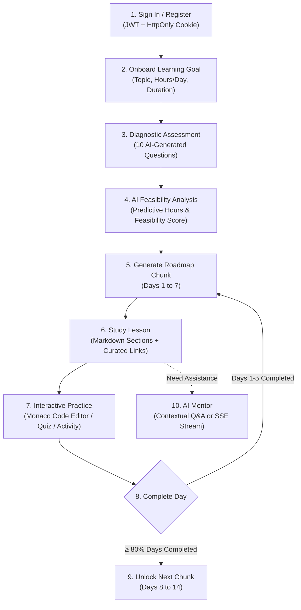

# PathAI — Autonomous AI-Powered Personal Learning Platform

[](.github/workflows/ci.yml)
[-success?style=flat-square&logo=pytest)](test-aitutor.py)
[](PersonalAITutorBackend)
[](PersonalAITutorBackend)
[](PersonalAITutorFrontend)
[](README.md#caching--performance-acceleration)
[-red?style=flat-square&logo=redis)](README.md#concurrency--rate-limiting-resilience)
[](docker-compose.yml)
[](LICENSE)

PathAI is an enterprise-grade, distributed AI learning tutor that orchestrates personalized study curricula for learners. Learners define learning goals, complete AI-generated adaptive diagnostic assessments, receive instant feasibility predictions, follow day-by-day chunked roadmaps, study structured interactive lessons, complete coding/quiz tasks, and converse with an in-lesson AI mentor using synchronous or Server-Sent Events (SSE) streaming responses.

The platform is architected as a reactive microservices system built on **Spring Cloud 2025**, **Spring Boot 3.5.8**, **Spring AI (Groq LLaMA 3.3 70B)**, **Redis 7**, **MySQL 8**, and **React 19 / Vite 7 SPA**.

---

## Table of Contents

- [Core Capabilities](#core-capabilities)
- [System Architecture](#system-architecture)
- [Learner Workflow](#learner-workflow)
- [Resilience, Security & Defense-in-Depth](#resilience-security--defense-in-depth)
- [Automated Test Suite & Benchmark Results](#automated-test-suite--benchmark-results)
  - [Test Suite Summary](#test-suite-summary)
  - [Measured Latency & Throughput Matrix](#measured-latency--throughput-matrix)
  - [Caching & Performance Acceleration](#caching--performance-acceleration)
  - [Concurrency & Rate Limiting Resilience](#concurrency--rate-limiting-resilience)
  - [Execution Breakdown (77/77 Verified Tests)](#execution-breakdown-7777-verified-tests)
  - [How to Run the Python Test Suite](#how-to-run-the-python-test-suite)
- [Configuration & Environment Harmonization](#configuration--environment-harmonization)
- [Quickstart & Deployment Guide](#quickstart--deployment-guide)
  - [Option A: Docker Compose (Recommended)](#option-a-docker-compose-recommended)
  - [Option B: Local Bare-Metal Multi-Service Setup](#option-b-local-bare-metal-multi-service-setup)
- [Frontend Routes](#frontend-routes)
- [REST API Reference](#rest-api-reference)
- [Production Readiness Checklist](#production-readiness-checklist)
- [License](#license)

---

## Core Capabilities

- **Personalized Goal Onboarding**: Captures topic goals, baseline self-assessment, target daily study hours, and preferred completion duration.
- **AI Diagnostic Skill Assessment**: Dynamically generates 10 tailored multiple-choice conceptual questions with rationale explanations to establish objective baseline proficiency.
- **Predictive Feasibility Engine**: Analyzes quiz performance against daily commitment and total target days, returning estimated required study hours, realistic completion forecasts, and feasibility status.
- **Chunked Day-by-Day Roadmaps**: Generates structured 7-day milestones per chunk with granular theory/practice breakdowns to maintain learner focus.
- **Progress Gating (80% Completion Rule)**: Enforces discipline by preventing premature generation of subsequent roadmap chunks until at least 80% of current days are verified completed.
- **On-Demand Lesson Generation with Multi-Tier Caching**: Synthesizes comprehensive markdown lessons with curated documentation and video links; warm reads from DB cache achieve **127.9x median speedup** over cold AI synthesis.
- **Dual-Mode AI Mentor**: Context-aware in-lesson mentorship supporting standard blocking JSON queries and real-time Server-Sent Events (SSE) streaming with low Time-to-First-Token (TTFT).
- **Monaco Code Editor Workspace**: In-browser coding workspace supporting multiple programming languages, local draft persistence, code reset, and snippet copying.
- **Zero-Trust Security**: Defends downstream microservices via Spring Cloud Gateway JWT validation, HttpOnly SameSite refresh token rotation, and internal secret validation (`X-Gateway-Secret`).
- **Redis Token Bucket Rate Limiting**: Distributed rate limiter (capacity: 10, refill: 2 tokens/sec) that throttles burst traffic with HTTP `429 Too Many Requests` while keeping the server responsive under high concurrency (402+ RPS).

---

## System Architecture

```text
                                 +---------------------------------------+
                                 |          React 19 + Vite SPA          |
                                 |         http://localhost:5173         |
                                 +-------------------+-------------------+
                                                     |
                                            HTTPS / REST / SSE
                                                     |
                                                     v
                                 +---------------------------------------+
                                 |        Spring Cloud API Gateway       |
                                 |         http://localhost:8080         |
                                 |  - JWT Bearer Authentication Filter   |
                                 |  - Redis Token Bucket Rate Limiting   |
                                 |  - Global CORS & Security Headers     |
                                 |  - Resilience4j Circuit Breakers      |
                                 |  - Injects X-Gateway-Secret Header    |
                                 +---+---------------+---------------+---+
                                     |               |               |
             +-----------------------+               |               +-----------------------+
             |                                       |                                       |
             v                                       v                                       v
+--------------------------+       +-----------------------------------+       +--------------------------+
|       User-Service       |       |       LearningPathGenerator       |       |        AI-Service        |
|  http://localhost:8081   |       |       http://localhost:8085       |       |  http://localhost:8083   |
|--------------------------|       |-----------------------------------|       |--------------------------|
| - Email/Pass + OAuth2    |       | - Goals & Quiz Orchestration      |       | - Spring AI 1.1.0        |
| - JWT Access (HS512)     |       | - Feasibility Analysis            |       | - Groq LLaMA 3.3 70B     |
| - Refresh Cookie Auth    |       | - 7-Day Chunked Roadmaps          |       | - Fallback Model Chains  |
| - User Profile Service   |       | - Lesson Generation & Caching     |       | - Direct AI Endpoints    |
| - Validates Secret       |       | - Day Progress Completion Gates   |       | - SSE Stream Generator   |
+------------+-------------+       | - Validates Secret / OpenFeign    |       +------------+-------------+
             |                     +-----------------+-----------------+                    |
             |                                       |                                      |
             +-------------------+                   |                                      |
                                 |                   |                                      |
                                 v                   v                                      |
                      +---------------------------------------+                             |
                      |          MySQL 8.0 Database           |                             |
                      |        http://localhost:3306          |                             |
                      |  - user_auth / users / credentials    |                             |
                      |  - learning_goals / roadmaps / lessons|                             |
                      +-------------------+-------------------+                             |
                                          |                                                 |
                                          +---------------------+                           |
                                                                |                           |
                                                                v                           v
                                                  +---------------------------+  +----------------------+
                                                  |      Redis 7 Alpine       |  |   Eureka Discovery   |
                                                  |   localhost:6380 (Host)   |  |     ServiceRegistry  |
                                                  |   redis:6379 (Container)  |  |    :8761 / eureka/   |
                                                  +---------------------------+  +----------------------+
```

### Microservice Inventory

| Service | Port (Host / Docker) | Technology Stack | Core Responsibility |
|:---|:---:|:---|:---|
| **`ServiceRegistry`** | `8761:8761` | Spring Cloud Netflix Eureka | Microservice registry, dynamic service discovery, and heartbeat monitoring. |
| **`ApiGateway`** | `8080:8080` | Spring Cloud Gateway, Redis, Resilience4j | Single client ingress, JWT verification, Redis token-bucket rate limiting, CORS management, circuit breaking, and secret propagation. |
| **`User-Service`** | `8081:8081` | Spring Boot, Spring Security, JPA, MySQL | User registration, login, JWT issuance (HS512), HttpOnly cookie management, refresh token rotation, Google & GitHub OAuth2. |
| **`LearningPathGenerator`** | `8085:8085` | Spring Boot, OpenFeign, JPA, Redis, MySQL | Diagnostic quiz evaluation, feasibility computation, chunked roadmap progression, lesson generation, completion tracking, and mentor routing. |
| **`AIService`** | `8083:8083` | Spring AI, Groq OpenAI API, WebFlux | LLM orchestration with primary `llama-3.3-70b-versatile` and fallback models (`llama-3.1-8b-instant`), prompt engineering, and SSE token streaming. |
| **`PersonalAITutorFrontend`** | `5173:80` | React 19, Vite 7, Monaco Editor, Nginx | Single-page application, interactive roadmap timeline, Monaco code editor, Markdown renderer, and chat UI. |
| **`MySQL`** | `3306:3306` | MySQL 8.0 Community | Persistent relational data store for user credentials, profiles, learning goals, roadmaps, days, and cached lessons. |
| **`Redis`** | `6380:6379` | Redis 7 Alpine | High-performance distributed store for rate limiting tokens and caching. |

---

## Learner Workflow



---

## Resilience, Security & Defense-in-Depth

### 1. Internal Defense Secret (`X-Gateway-Secret`)
All internal microservices (`User-Service`, `LearningPathGenerator`, `AIService`) enforce security via interceptors that validate an internal shared secret. Any request attempting to bypass the API Gateway directly is instantly rejected with HTTP `401 Unauthorized` or `403 Forbidden`. The API Gateway strips incoming client `X-Gateway-Secret` headers and injects the authentic secret before routing downstream.

### 2. Redis Token-Bucket Rate Limiter
The API Gateway implements a distributed Redis token-bucket rate limiter:
- **Bucket Capacity:** 10 tokens
- **Refill Rate:** 2 tokens / second
- **Request Cost:** 1 token
- **Key Prefix:** `aitutor:gateway:rate-limit:<client_ip>`
- **Fail-Open Policy:** Protected services reject excess load with HTTP `429 Too Many Requests` rather than allowing server thread exhaustion. Under a 40-request concurrent burst, the limiter cleanly throttles excess calls while preserving **zero connection or 5xx server errors**.

### 3. Multi-Tier Caching
- **Feasibility Reports**: Stored in DB and cached in memory. Subsequent reads achieve **15.60 ms** response times compared to 1,115 ms cold generation (**71.5x speedup**).
- **Generated Lessons**: Persisted in MySQL upon initial AI synthesis. Repeat reads achieve **27.58 ms** median latency compared to 3,526 ms cold AI synthesis (**127.9x speedup**).

### 4. Circuit Breakers & Timeout Controls
Configured via Resilience4j across all Gateway routes:
- Sliding window size: 10 calls, 50% failure threshold, 15s wait duration in open state.
- Tailored TimeLimiter settings: Standard API calls timeout at 10s; AI generation and lesson synthesis routes permit up to 90s before triggering graceful fallbacks.

---

## Automated Test Suite & Benchmark Results

The entire platform is continuously validated using the automated end-to-end Python test suite in [`test-aitutor.py`](test-aitutor.py).

### Test Suite Summary

| Metric | Result |
|:---|:---:|
| **Test Script** | [`test-aitutor.py`](test-aitutor.py) |
| **Total Test Assertions** | **77** |
| **Passed** | **77 (100%)** |
| **Failed** | **0** |
| **Skipped** | **0** |
| **Total HTTP Requests Executed** | **145** |
| **Total Benchmark Duration** | **74.01 seconds** |
| **Overall Mean Latency** | **214.84 ms** |
| **Overall Median Latency (P50)** | **20.34 ms** |
| **Overall 95th Percentile Latency (P95)** | **1,568.47 ms** |
| **Zero 5xx Server / Connection Errors** | **Verified (0)** |

### Measured Latency & Throughput Matrix

The following real-world performance metrics were captured during benchmark execution against the running services:

| Endpoint / Operation | HTTP Method | Samples | Min (ms) | P50 Median (ms) | Avg (ms) | P95 (ms) | Max (ms) | Operational Classification |
|:---|:---:|:---:|:---:|:---:|:---:|:---:|:---|
| `/health` | `GET` | 6 | 7.44 | **7.77** | 7.99 | 8.66 | 254.16 | Gateway & Service Health Probe |
| `/helloAI` | `GET` | 1 | 1,207.24 | **1,207.24** | 1,207.24 | 1,207.24 | 1,207.24 | Direct AI Service Ping |
| `/api/auth/signup` (Input Validation) | `POST` | 1 | 299.46 | **299.46** | 299.46 | 299.46 | 299.46 | 400 Bad Request on Blank Inputs |
| `/api/auth/signup` (Success) | `POST` | 1 | 88.75 | **88.75** | 88.75 | 88.75 | 88.75 | BCrypt Hash & User Creation |
| `/api/auth/login` (Unauthorized) | `POST` | 1 | 80.44 | **80.44** | 80.44 | 80.44 | 80.44 | 401 on Bad Password |
| `/api/auth/login` (Benchmark Profile) | `POST` | 6 | 84.84 | **89.21** | 90.81 | 98.96 | 100.36 | JWT HS512 Issuance & Set-Cookie |
| `/api/auth/refresh` | `POST` | 1 | 23.16 | **23.16** | 23.16 | 23.16 | 23.16 | HttpOnly Cookie Rotation |
| `/api/user/profile` | `GET` | 6 | 17.27 | **17.76** | 18.61 | 21.39 | 26.35 | Authenticated Profile Read |
| `/api/path/testSkills` | `POST` | 1 | 2,147.47 | **2,147.47** | 2,147.47 | 2,147.47 | 2,147.47 | 10-Question Diagnostic Quiz Gen |
| `/api/path/feasibility` (Cold AI) | `POST` | 1 | 1,115.13 | **1,115.13** | 1,115.13 | 1,115.13 | 1,115.13 | AI Prediction & Feasibility |
| `/api/path/feasibility` (Cached Warm) | `POST` | 4 | 14.63 | **15.60** | 15.40 | 15.78 | 15.79 | **71.5x Speedup** vs Cold Call |
| `/api/path/roadmap` (Days 1-7) | `POST` | 1 | 1,528.32 | **1,528.32** | 1,528.32 | 1,528.32 | 1,528.32 | Initial 7-Day Chunk Synthesis |
| `/api/path/goals` | `GET` | 6 | 15.82 | **17.99** | 19.08 | 22.52 | 22.79 | User Goal State Query |
| `/api/path/goals/{goalId}` | `GET` | 6 | 12.59 | **13.91** | 14.59 | 18.63 | 19.77 | Single Goal State Resumption |
| `/api/path/roadmap/{goalId}/days` | `GET` | 6 | 20.97 | **22.74** | 22.47 | 24.06 | 32.76 | Day Metadata & Completion Status |
| `/api/path/roadmap/{id}/day/1/lesson` (Cold) | `GET` | 1 | 3,526.62 | **3,526.62** | 3,526.62 | 3,526.62 | 3,526.62 | Cold AI Synthesis (3,956 chars) |
| `/api/path/roadmap/{id}/day/1/lesson` (Warm) | `GET` | 5 | 25.31 | **27.58** | 29.06 | 34.49 | 35.52 | **127.9x Speedup** via DB Cache |
| `/api/path/roadmap` (Days 8-14 Gate Block) | `POST` | 1 | 25.09 | **25.09** | 25.09 | 25.09 | 25.09 | 400 Bad Request (< 80% complete) |
| `/api/path/roadmap/{id}/day/{n}/complete` | `PATCH` | 6 | 20.34 | **21.41** | 23.36 | 34.48 | 34.48 | Day Completion State Updates |
| `/api/path/roadmap` (Days 8-14 Unlocked) | `POST` | 1 | 1,578.50 | **1,578.50** | 1,578.50 | 1,578.50 | 1,578.50 | Success after 85.7% completion |
| `/api/path/chat` (Blocking AI Mentor) | `POST` | 1 | 1,133.95 | **1,133.95** | 1,133.95 | 1,133.95 | 1,133.95 | Synchronous Mentor Response |
| `/api/path/chat/stream` (SSE TTFT) | `POST` | 3 | 2,223.36 | **2,568.71** | 2,548.67 | 2,825.42 | 2,853.94 | Time-to-First-Token (~2.5s) |
| `/api/path/generate` (Legacy Path) | `POST` | 1 | 3,002.55 | **3,002.55** | 3,002.55 | 3,002.55 | 3,002.55 | Legacy Curriculum Generation |
| `/api/path/all` (Tenancy Isolation) | `GET` | 6 | 12.12 | **13.41** | 13.50 | 14.42 | 14.47 | Multi-Tenant Privacy Isolation |
| `/api/ai/generate` (Direct LLM) | `POST` | 1 | 4,486.75 | **4,486.75** | 4,486.75 | 4,486.75 | 4,486.75 | Raw LLM Completion Endpoint |
| `/api/auth/logout` | `POST` | 1 | 18.65 | **18.65** | 18.65 | 18.65 | 18.65 | Token Revocation & Cleanup |

### Caching & Performance Acceleration

| Resource Type | Cold AI Latency | Warm DB Cache (Median) | Performance Multiplier |
|:---|:---:|:---:|:---:|
| **Comprehensive Lesson Generation** | **3,526.62 ms** | **27.58 ms** | **127.9x Faster** |
| **Feasibility Assessment Report** | **1,115.13 ms** | **15.60 ms** | **71.5x Faster** |

### Concurrency & Rate Limiting Resilience

- **Concurrent Burst Test (25 Workers)**:
  - 10 requests allowed (`200 OK`) inside the bucket capacity.
  - 15 requests gracefully throttled with `429 Too Many Requests`.
  - Zero 5xx errors or broken socket connections (Avg: 30.42 ms, P95: 44.68 ms).
- **Sustained Concurrent Load (40 Requests @ 8 Concurrent Workers)**:
  - **Throughput:** **402.53 Requests / Second**
  - **P50 Latency:** **16.15 ms**
  - **P95 Latency:** **25.55 ms**
  - **P99 Latency:** **33.95 ms**
  - **Server / Connection Errors:** **0**

### Execution Breakdown (77/77 Verified Tests)

<details>
<summary><strong>Click to expand the complete list of 77 automated test results</strong></summary>

| # | Test Name | Expected | Status Code | Latency | Result |
|:---:|:---|:---:|:---:|:---:|:---:|
| 1 | Gateway / Learning Path Health | `[200]` | `200` | 254.16 ms | **PASS** |
| 2 | Gateway `/health` Latency Profile [5x Samples] | `5/5 in (200,)` | `BENCHMARKED` | 7.77 ms | **PASS** |
| 3 | AI Service Hello | `[200]` | `200` | 1,207.24 ms | **PASS** |
| 4 | AI Hello returned meaningful text | Valid response | `ASSERTION` | — | **PASS** |
| 5 | Signup Validation - Empty Fields | `[400, 422]` | `400` | 299.46 ms | **PASS** |
| 6 | Signup Valid User | `[200]` | `200` | 88.75 ms | **PASS** |
| 7 | Invalid Login Handling | `[400, 401, 403]` | `401` | 80.44 ms | **PASS** |
| 8 | Valid Login & JWT Issuance | `[200]` | `200` | 93.61 ms | **PASS** |
| 9 | Login returned access token | Valid token | `ASSERTION` | — | **PASS** |
| 10 | Auth JWT Login Latency Profile [5x Samples] | `5/5 in (200,)` | `BENCHMARKED` | 89.21 ms | **PASS** |
| 11 | Refresh Token Rotation | `[200]` | `200` | 23.16 ms | **PASS** |
| 12 | Refresh returned new access token | Valid token | `ASSERTION` | — | **PASS** |
| 13 | Access token rotated | Valid token | `ASSERTION` | — | **PASS** |
| 14 | Security: Unauthorized User Profile | `[401, 403]` | `401` | 3.86 ms | **PASS** |
| 15 | Security: Unauthorized Goals | `[401, 403]` | `401` | 3.40 ms | **PASS** |
| 16 | Security: Invalid JWT Signature | `[401, 403]` | `401` | 26.06 ms | **PASS** |
| 17 | Security: User ID Header Spoofing Blocked | `[401, 403]` | `401` | 3.21 ms | **PASS** |
| 18 | Get User Profile | `[200]` | `200` | 26.35 ms | **PASS** |
| 19 | Profile belongs to authenticated user | Valid ID | `ASSERTION` | — | **PASS** |
| 20 | Get User Profile Latency Profile [5x Samples] | `5/5 in (200,)` | `BENCHMARKED` | 17.76 ms | **PASS** |
| 21 | Generate Diagnostic Quiz | `[200]` | `200` | 2,147.47 ms | **PASS** |
| 22 | Quiz questions generated (Count: 10) | Valid count | `ASSERTION` | — | **PASS** |
| 23 | Quiz question structure (with explanations) | Verified | `ASSERTION` | — | **PASS** |
| 24 | Quiz did not use degraded fallback | Live AI | `ASSERTION` | — | **PASS** |
| 25 | AI Feasibility Analysis (Cold) | `[200]` | `200` | 1,115.13 ms | **PASS** |
| 26 | Feasibility response contains isFeasible | Boolean | `ASSERTION` | — | **PASS** |
| 27 | Estimated days is positive (67 days) | > 0 | `ASSERTION` | — | **PASS** |
| 28 | Expected outcome returned (`job-ready`) | Expected | `ASSERTION` | — | **PASS** |
| 29 | Feasibility reason returned | Text | `ASSERTION` | — | **PASS** |
| 30 | Feasibility did not use degraded fallback | Live AI | `ASSERTION` | — | **PASS** |
| 31 | Feasibility Refresh / Cached Read [4x Samples] | `4/4 in (200,)` | `BENCHMARKED` | 15.60 ms | **PASS** |
| 32 | Generate First 7 Days Roadmap | `[200]` | `200` | 1,528.32 ms | **PASS** |
| 33 | Roadmap contains 7 days | Count = 7 | `ASSERTION` | — | **PASS** |
| 34 | Roadmap has valid day topics | Topics valid | `ASSERTION` | — | **PASS** |
| 35 | Roadmap did not use degraded fallback | Live AI | `ASSERTION` | — | **PASS** |
| 36 | Get All User Goals | `[200]` | `200` | 18.80 ms | **PASS** |
| 37 | New goal saved in database | Persisted | `ASSERTION` | — | **PASS** |
| 38 | Get All User Goals Latency Profile [5x Samples] | `5/5 in (200,)` | `BENCHMARKED` | 17.99 ms | **PASS** |
| 39 | Get Single Goal Details (State Resume) | `[200]` | `200` | 15.38 ms | **PASS** |
| 40 | Single goal status is `ROADMAP_GENERATED` | Match | `ASSERTION` | — | **PASS** |
| 41 | Get Single Goal Latency Profile [5x Samples] | `5/5 in (200,)` | `BENCHMARKED` | 13.91 ms | **PASS** |
| 42 | Get Roadmap Days | `[200]` | `200` | 32.76 ms | **PASS** |
| 43 | Roadmap days persisted in database | Count = 7 | `ASSERTION` | — | **PASS** |
| 44 | Get Roadmap Days Latency Profile [5x Samples] | `5/5 in (200,)` | `BENCHMARKED` | 22.74 ms | **PASS** |
| 45 | Generate Lesson Day 1 (Cold AI Call) | `[200]` | `200` | 3,526.62 ms | **PASS** |
| 46 | Lesson content generated (3,956 characters) | > 0 chars | `ASSERTION` | — | **PASS** |
| 47 | Lesson task type returned (`ACTIVITY`) | Expected | `ASSERTION` | — | **PASS** |
| 48 | Lesson did not use degraded fallback | Live AI | `ASSERTION` | — | **PASS** |
| 49 | Curated Links (3 YouTube + 2 Docs) | Total = 5 | `ASSERTION` | — | **PASS** |
| 50 | Fetch Lesson Day 1 (DB Cache Warm Reads) [5x] | `5/5 in (200,)` | `BENCHMARKED` | 27.58 ms | **PASS** |
| 51 | 80% Gate Block Check (Premature Days 8-14) | `[400]` | `400` | 25.09 ms | **PASS** |
| 52 | Mark Day 1 Complete | `[200]` | `200` | 34.48 ms | **PASS** |
| 53 | Mark Day 2 Complete | `[200]` | `200` | 22.15 ms | **PASS** |
| 54 | Mark Day 3 Complete | `[200]` | `200` | 20.81 ms | **PASS** |
| 55 | Mark Day 4 Complete | `[200]` | `200` | 21.41 ms | **PASS** |
| 56 | Mark Day 5 Complete | `[200]` | `200` | 20.96 ms | **PASS** |
| 57 | Mark Day 6 Complete | `[200]` | `200` | 20.34 ms | **PASS** |
| 58 | Verify Day 1-6 Completion Persisted | `[200]` | `200` | 22.59 ms | **PASS** |
| 59 | 6 of 7 days marked completed in DB (85.7%) | 6/7 verified | `ASSERTION` | — | **PASS** |
| 60 | Generate Days 8-14 (Unlocked at 85.7%) | `[200]` | `200` | 1,578.50 ms | **PASS** |
| 61 | Days 8-14 generated cleanly | Count = 7 | `ASSERTION` | — | **PASS** |
| 62 | AI Mentor Chat (Blocking Synchronous) | `[200]` | `200` | 1,133.95 ms | **PASS** |
| 63 | AI chat returned meaningful explanation | Expected | `ASSERTION` | — | **PASS** |
| 64 | AI chat did not return fallback message | Live AI | `ASSERTION` | — | **PASS** |
| 65 | AI Mentor Chat (SSE Stream TTFT) [3x Samples] | `[200]` | `200` | 2,568.71 ms | **PASS** |
| 66 | Generate Career Learning Path (Legacy) | `[200]` | `200` | 3,002.55 ms | **PASS** |
| 67 | Legacy AI path returned valid JSON | Valid JSON | `ASSERTION` | — | **PASS** |
| 68 | Get All Learning Paths | `[200]` | `200` | 13.02 ms | **PASS** |
| 69 | Learning paths endpoint returned a list | List valid | `ASSERTION` | — | **PASS** |
| 70 | Security: No other users' paths exposed | Foreign = 0 | `ASSERTION` | — | **PASS** |
| 71 | Get All Learning Paths Latency Profile [5x Samples] | `5/5 in (200,)` | `BENCHMARKED` | 13.41 ms | **PASS** |
| 72 | Direct AI Generate API | `[200]` | `200` | 4,486.75 ms | **PASS** |
| 73 | Direct AI generated meaningful response | Expected | `ASSERTION` | — | **PASS** |
| 74 | Concurrent Redis Rate-Limiter Burst (25 requests) | 200 + 429 | `COMPLETED` | 30.42 ms | **PASS** |
| 75 | Sustained Concurrent Load (40 reqs @ 8 workers) | Zero 5xx | `COMPLETED` | 17.20 ms | **PASS** |
| 76 | User Logout | `[200]` | `200` | 18.65 ms | **PASS** |
| 77 | Security: Logout Revokes Refresh Token | `401` | `401` | — | **PASS** |

</details>

### How to Run the Python Test Suite

The test suite requires Python 3.8+ and the standard `requests` library:

```powershell
# 1. Install dependencies
pip install requests

# 2. Run the test suite against the local stack
python test-aitutor.py
```

Optional environment variable overrides for custom test environments:

```powershell
$env:BASE_URL = "http://localhost:8080"
$env:AI_BASE_URL = "http://localhost:8083"
$env:AI_GATEWAY_SECRET = "3b5234cd94a6aaf7618ec79ca4d4ecff21d248d4fd43f3cf"
python test-aitutor.py
```

---

## Configuration & Environment Harmonization

The configuration across `.env`, `docker-compose.yml`, and individual service `application.properties` has been unified to avoid missing placeholder errors and port mismatches.

| Config Variable | Default Value | Relevant Services | Purpose |
|:---|:---|:---|:---|
| `DB_NAME` | `aitutor` | MySQL, User-Service, LearningPath | MySQL database name |
| `DB_USER` / `MYSQL_USERNAME` | `aitutor` | MySQL, User-Service, LearningPath | Database username |
| `DB_PASSWORD` / `MYSQL_PASSWORD` | `aitutor_password` | MySQL, User-Service, LearningPath | Database user password |
| `DB_ROOT_PASSWORD` | `root_password` | MySQL | MySQL root administrative password |
| `DB_URL` | `jdbc:mysql://localhost:3306/aitutor?...` | User-Service, LearningPath | Full JDBC URL (Docker Compose auto-routes to container `mysql:3306`) |
| `APP_GATEWAY_SECRET` / `INTERNAL_SECRET` | `3b5234cd...` | Gateway, User, LearningPath, AI | Shared zero-trust microservice header secret (`X-Gateway-Secret`) |
| `JWT_SECRET` / `APP_JWT_SECRET` | `replace_with_secret_min_32_chars` | Gateway, User-Service | HMAC-SHA512 JWT signing and verification key |
| `JWT_ISSUER` / `APP_JWT_ISSUER` | `aitutor-user-service` | User-Service | JWT issuer identifier claim |
| `BASE_URL` / `APP_BASE_URL` | `http://localhost:5173` | User-Service | Frontend client origin for OAuth2 redirect callbacks |
| `CORS_ALLOWED_ORIGINS` | `http://localhost:5173` | ApiGateway | Allowed CORS origins for browser AJAX/fetch requests |
| `VITE_API_BASE_URL` | `http://localhost:8080` | Frontend SPA | Backend API Gateway ingress URL |
| `VITE_ENABLE_CHAT_STREAMING` | `false` | Frontend SPA | Enables real-time SSE streaming mentor endpoint when `true` |
| `OPENAI_API_KEY` | *(Required)* | AIService | Groq Cloud API key for Spring AI |
| `GROQ_PRIMARY_MODEL` | `llama-3.3-70b-versatile` | AIService | Primary LLM model for lesson, quiz, and mentor generation |
| `GROQ_FALLBACK_MODELS` | `llama-3.1-8b-instant,...` | AIService | Failover LLM models if primary model encounters rate limits |
| `REDIS_HOST` | `localhost` (Host) / `redis` (Docker) | Gateway, LearningPath | Redis hostname |
| `REDIS_PORT` | `6380` (Host) / `6379` (Docker) | Gateway, LearningPath | Redis port |
| `EUREKA_CLIENT_SERVICEURL_DEFAULTZONE` | `http://localhost:8761/eureka/` | All Backend Services | Eureka Discovery Registry endpoint |

---

## Quickstart & Deployment Guide

### Option A: Docker Compose (Recommended)

Run the entire platform (databases, backend microservices, and Nginx-hosted frontend) with a single command:

```powershell
# 1. Copy the unified environment template
Copy-Item .env.example .env

# 2. Add your Groq API key in .env
# OPENAI_API_KEY=gsk_your_actual_key_here

# 3. Launch the stack
docker compose up --build -d

# 4. View real-time logs
docker compose logs -f
```

Services will boot in strict dependency order:
1. `aitutor-redis` & `aitutor-mysql` initialize healthchecks.
2. `aitutor-eureka` starts and awaits registry readiness.
3. `aitutor-user-service`, `aitutor-learning-path-service`, and `aitutor-ai-service` start and register with Eureka.
4. `aitutor-gateway` starts, verifies Redis connectivity, and exposes port `8080`.
5. `aitutor-frontend` builds with Vite and serves static assets via Nginx on `http://localhost:5173`.

To stop the stack:
```powershell
docker compose down
```

---

### Option B: Local Bare-Metal Multi-Service Setup

#### Prerequisites
- **Java 17+** & **Maven 3.8+**
- **Node.js 20+** & **npm 10+**
- **MySQL 8.0** running on port `3306`
- **Redis 7** running on port `6380` (e.g., via `docker run -p 6380:6379 redis:7-alpine`)
- **Groq API Key**

#### Step 1: Initialize Database
```sql
CREATE DATABASE IF NOT EXISTS aitutor;
```

#### Step 2: Configure Environment
Copy `.env.example` to `.env` in the project root and add your Groq API key:
```powershell
Copy-Item .env.example .env
```

#### Step 3: Start Backend Services (Separate Terminals)

```powershell
# Terminal 1 — Eureka Service Registry
cd PersonalAITutorBackend/ServiceRegistry
mvn spring-boot:run

# Terminal 2 — API Gateway
cd PersonalAITutorBackend/ApiGateway
mvn spring-boot:run

# Terminal 3 — User Service
cd PersonalAITutorBackend/User-Service
mvn spring-boot:run

# Terminal 4 — AI Service
cd PersonalAITutorBackend/AIService
mvn spring-boot:run

# Terminal 5 — Learning Path Generator
cd PersonalAITutorBackend/LearningPathGenerator
mvn spring-boot:run
```

#### Step 4: Start Frontend Single-Page Application

```powershell
# Terminal 6 — React 19 Frontend
cd PersonalAITutorFrontend
Copy-Item .env.example .env
npm install
npm run dev
```

Open `http://localhost:5173` in your browser.

---

## Frontend Routes

All interactive workspace views reside under the protected `/app/**` namespace:

| Route | Access | Component View | Description |
|:---|:---:|:---|:---|
| `/` | Public | `LandingPage` | Platform overview, features, and call-to-action |
| `/login` | Public | `Login` | Email/password login and Google/GitHub OAuth links |
| `/register` | Public | `Register` | Account registration with field validations |
| `/auth/success` | Callback | `AuthSuccess` | OAuth2 callback processing and token exchange |
| `/app` | Protected | `Dashboard` | Active learning paths, statistics, and quick navigation |
| `/app/start` | Protected | `StartGoal` | New goal creation with duration and difficulty inputs |
| `/app/quiz` | Protected | `DiagnosticQuiz` | 10-question adaptive diagnostic assessment |
| `/app/feasibility` | Protected | `FeasibilityReport` | Feasibility rating, estimated hours, and roadmap trigger |
| `/app/roadmap/:goalId` | Protected | `RoadmapView` | Interactive roadmap timeline with chunk controls |
| `/app/lesson/:goalId/:dayNumber` | Protected | `LessonView` | Markdown lesson, curated materials, and Monaco editor |
| `/app/explore` | Protected | `ExploreLibrary` | Library of generated lessons across goals |
| `/app/profile` | Protected | `UserProfile` | Account settings, study preferences, and logout |

---

## REST API Reference

The client communicates exclusively through the API Gateway at `http://localhost:8080`.

### Authentication & User Identity (`User-Service`)

| Method | Endpoint | Auth | Description |
|:---|:---|:---:|:---|
| `POST` | `/api/auth/signup` | Public | Register new user with email, password, and name |
| `POST` | `/api/auth/login` | Public | Authenticate user; returns JWT and sets HttpOnly refresh cookie |
| `POST` | `/api/auth/refresh` | Cookie | Rotates JWT access token using the refresh cookie |
| `POST` | `/api/auth/logout` | Bearer | Revokes active refresh token and clears auth state |
| `GET` | `/api/user/profile` | Bearer | Fetches profile for authenticated user |
| `GET` | `/oauth2/authorization/google` | Public | Initiates Google OAuth2 authentication flow |
| `GET` | `/oauth2/authorization/github` | Public | Initiates GitHub OAuth2 authentication flow |

### Learning Path & Lessons (`LearningPathGenerator`)

| Method | Endpoint | Auth | Description |
|:---|:---|:---:|:---|
| `POST` | `/api/path/testSkills` | Bearer | Generates 10-question diagnostic quiz for a goal |
| `POST` | `/api/path/feasibility` | Bearer | Calculates study feasibility from quiz results |
| `POST` | `/api/path/roadmap?startDay=1&days=7` | Bearer | Synthesizes a chunk of 7 roadmap days |
| `GET` | `/api/path/goals` | Bearer | Lists all learning goals belonging to the authenticated user |
| `GET` | `/api/path/goals/{goalId}` | Bearer | Retrieves full metadata and feasibility state for a goal |
| `GET` | `/api/path/roadmap/{goalId}/days` | Bearer | Retrieves roadmap days and completion state |
| `GET` | `/api/path/roadmap/{goalId}/day/{day}/lesson` | Bearer | Generates or fetches cached lesson content |
| `PATCH` | `/api/path/roadmap/{goalId}/day/{day}/complete` | Bearer | Marks a roadmap day as completed |
| `POST` | `/api/path/chat` | Bearer | Synchronous in-lesson AI mentor query |
| `POST` | `/api/path/chat/stream` | Bearer | Server-Sent Events (SSE) streaming AI mentor response |
| `POST` | `/api/path/generate` | Bearer | Legacy multi-week curriculum generation |
| `GET` | `/api/path/all` | Bearer | Lists legacy paths (enforces user tenancy isolation) |

### AI Generation Service (`AIService`)

| Method | Endpoint | Auth | Description |
|:---|:---|:---:|:---|
| `GET` | `/helloAI` | Internal | Health ping verifying LLM connectivity |
| `POST` | `/api/ai/generate` | Internal | Direct text completion via Spring AI |
| `POST` | `/api/ai/generate/json` | Internal | Structured JSON completion |

---

## Production Readiness Checklist

Before deploying to public cloud environments (AWS, GCP, Azure, or Kubernetes):

- [ ] **HTTPS / TLS Termination**: Terminate TLS at your cloud load balancer or reverse proxy.
- [ ] **Secure Refresh Cookies**: Set `REFRESH_COOKIE_SECURE=true` and `REFRESH_COOKIE_SAME_SITE=Strict` in production.
- [ ] **Secrets Management**: Store `JWT_SECRET`, `APP_GATEWAY_SECRET`, and `OPENAI_API_KEY` in AWS Secrets Manager, HashiCorp Vault, or Kubernetes Secrets.
- [ ] **CORS Restriction**: Set `CORS_ALLOWED_ORIGINS` to your production frontend domain (e.g., `https://learn.yourdomain.com`).
- [ ] **Rate Limit Tuning**: Adjust `gateway.rate-limit.capacity` and `gateway.rate-limit.refill-tokens` in Gateway properties based on expected peak traffic.
- [ ] **Monitoring & Prometheus**: Scrape `/actuator/prometheus` on Gateway port `5051` into Grafana for real-time latency and circuit-breaker telemetry.

---

## License

This project is licensed under the terms of the [MIT License](LICENSE).
